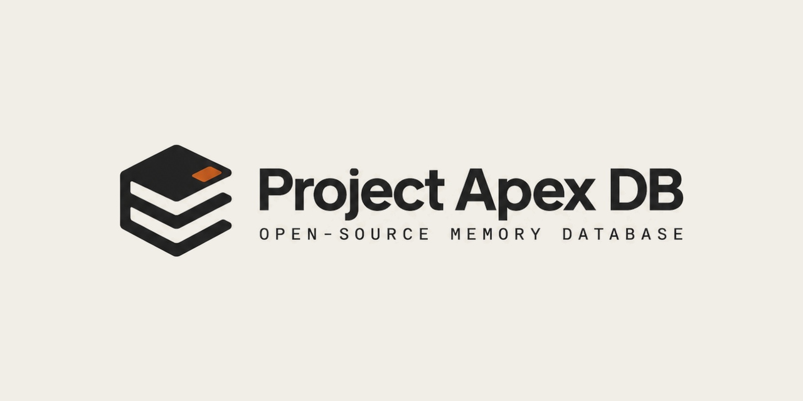

<p align="center">
  
</p>

<p align="center">
  <a href="https://project-apex-db.vercel.app"><b>Website</b></a> ·
  <a href="docs/GATES.md">Status and evidence</a> ·
  <a href="docs/SECURITY.md">Security model</a> ·
  <a href="docs/HANDOFF.md">Handoff</a>
</p>

# Project Apex DB

An open-source database for AI agent memory, written in Rust.

It writes every change to a write-ahead log, keeps each tenant's records separate, and applies a retried write once. It runs as an embedded library inside your own process.

> **Early development. Not ready for production.** There are no search benchmarks yet, so this project makes no speed claims and no comparison with other databases. See [Status](#status) for what is done and what is not.

## Why

An agent that runs for days has to remember earlier work, keep one user's data apart from another's, and cope with a request that may or may not have been applied. Most projects write that logic themselves, across a vector index, metadata tables, retry code and custom persistence. Project Apex puts the log, tenant scoping and retry handling in the database, to find out whether that is simpler than doing it in application code.

## What it does

| Feature | How it works |
|---|---|
| **Durable writes** | Each record is appended to a write-ahead log with a CRC32 checksum. On startup the log is replayed to rebuild state. If the log is corrupt, opening fails with `WAL_CORRUPT` instead of skipping records. |
| **Tenant isolation** | Each query runs in a scope: the caller's permissions intersected with the key's allowed scopes. Tests check that a query never returns another tenant's records, including when an index panics. |
| **Idempotent writes** | A retried write with the same operation id and identical bytes takes effect once. If the outcome of a commit cannot be determined, the caller gets `OUTCOME_UNKNOWN` instead of a guess. |
| **Swappable index** | Search goes through the `AnnIndex` trait. The brute-force `FlatIndex` returns exact results and is the reference any approximate index has to match. No approximate index is wired in yet. |

## Design

1. **The log comes first.** The write-ahead log is the source of truth. The index is rebuilt from it on startup and is never trusted from disk.
2. **Isolation has its own tests.** Tenant boundaries are covered by tests for concurrent tenants, a panicking index and replay after a crash.
3. **Numbers come with conditions.** Latency, recall, throughput and memory are reported together, with the dataset, hardware and build settings used.
4. **Evidence is tied to a snapshot.** Each test result is recorded against a digest of the source. Change a file and the old result no longer counts until it is re-run.

## Repository layout

```text
crates/
  atlas-core/      shared types, errors, scope model
  atlas-storage/   write-ahead log, recovery
  atlas-index/     AnnIndex trait, FlatIndex, conformance tests
  atlas-engine/    ties the log, index and scoping together
ci/                production-dependency-graph checks
scripts/           verify.sh, verify-linux.sh, digest.sh
docs/              status, security model, WAL format, durability notes, plan
site/              the project website (plain HTML, CSS and JavaScript)
```

The crates keep their internal `atlas-*` names. The public name is Project Apex DB.

## Build and test

You need a recent stable Rust toolchain.

```bash
cargo build --workspace
cargo test --workspace
```

The full scripted check (format, clippy with warnings denied, tests, production dependency graph):

```bash
bash scripts/verify.sh          # Windows or Linux host
bash scripts/verify-linux.sh    # Linux in Docker
bash scripts/digest.sh          # digest of the source snapshot the results belong to
```

## Status

What was measured, and where:

| Item | Result |
|---|---|
| Tests, Windows | 141 passed, 0 failed, 2 ignored |
| Tests, Linux (Docker) | 141 passed on the same digest |
| Production dependency graph | 54 checks pass |
| Memory during log replay | 1,000,000 operation-map entries: 1,322 B retained per entry, 1.34 GB peak working set (Windows, release build). This is a memory test of replay and says nothing about search speed. |

Not done:

- A capacity policy for the operation map and tenant partitions. This blocks production use.
- An approximate index and filtered-search acceptance.
- macOS: untested.
- Power loss: the durability tests kill the process, which is not the same as losing power.
- A peak-memory run on Linux.
- An independent review of the current source digest.

[`docs/GATES.md`](docs/GATES.md) is the source of truth and lists each result against its source digest. Missing evidence is never counted as a pass.

## Benchmarks

None have been run. When they exist, each result will list the dataset, hardware, build settings and the commands to reproduce it. Comparisons will use the same hardware, data, query mix, concurrency and recall target, and name the product versions and settings. The planned measurements are listed on the [website](https://project-apex-db.vercel.app/#benchmarks).

## Where it fits

Project Apex stores and retrieves data. It is not a model, an agent framework or a hosted service.

- **Try it if** you want a database that logs every write, scopes queries by tenant and applies retries once, and you are happy to read the source and report problems.
- **Stay with PostgreSQL if** you need relational queries, transactions or a vector index that works today. pgvector covers exact and approximate search.
- **Stay with your vector database if** you need approximate search at scale now.

## Contributing

These contributions help most right now:

- **Report a bug**, with the steps to reproduce it and the platform you ran it on.
- **Add a failure test** for a crash, a retry or a tenant mix-up the current tests do not cover.
- **Write a benchmark**: a dataset and query mix you care about, with a script others can run.
- **Check the claims.** Read [`docs/GATES.md`](docs/GATES.md) and point out anything the evidence does not support.

Test and review results are tied to a source digest, so run `bash scripts/digest.sh` before and after a change and say which digest your results belong to.

## The website

The site in [`site/`](site/) is static, with no build step. It uses GSAP and ScrollTrigger, Lenis for smooth scrolling and three.js for the hero rings, all vendored in `site/vendor/`. To preview it:

```bash
cd site
python -m http.server 8099
```

It is deployed on Vercel from `main`, with `site/` as the root directory.

## License

Apache-2.0.
